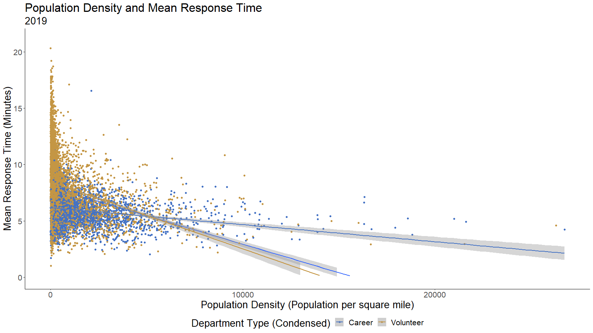
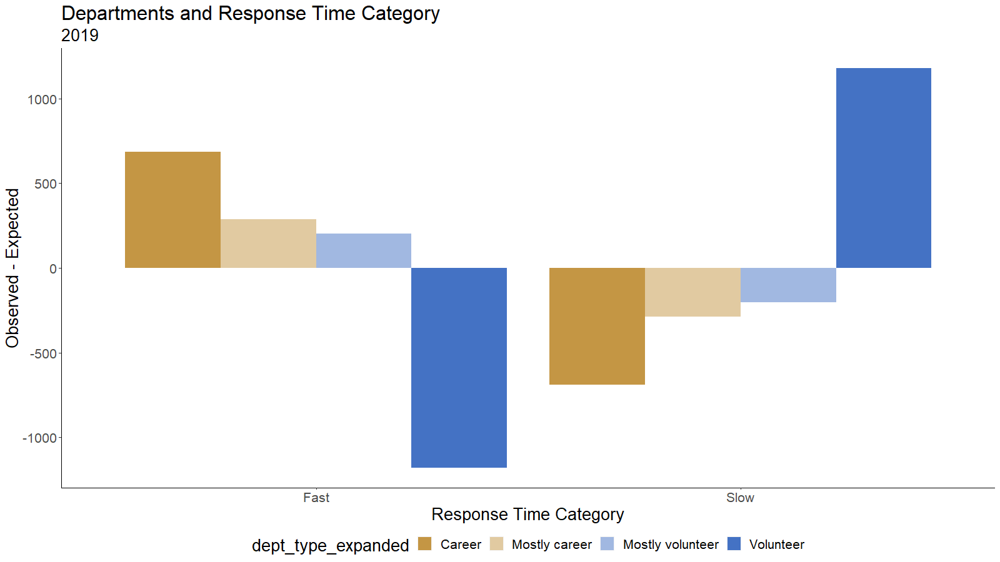

Final project for STAT 3120 (Kennesaw State University), done with Gabriel Salisbury in May 2023. The slide deck is the main write-up; this page summarizes it.

## Question

Is there a statistically significant difference in mean response time (dispatch to arrival) between career and volunteer fire departments? And how does population density relate to response time?

## The Presentation

<iframe src="Final-Project-Presentation.pdf" title="Final project presentation" width="100%" height="520" style="border: 1px solid var(--bs-border-color);"></iframe>

[Download the slides (PDF)](Final-Project-Presentation.pdf){.btn .btn-outline-primary .btn-sm}
[Code and data on GitHub](https://github.com/kai-do/stat-3120-final-project){.btn .btn-outline-primary .btn-sm}

## Data and Cleaning

The data is the public 2019 NFIRS (National Fire Incident Reporting System) incident data, rolled up to one row per department: **11,884 departments**, each with at least 30 incidents. Incident-level cleaning, documented on the last slide of the deck, kept geocoded incidents and dropped mutual-aid incidents, incidents with a missing response time, and extreme response times. Departments and census tracts with very few incidents were also dropped.

Variables used:

| Variable | Definition | Used in |
|---|---|---|
| Mean response time | Mean dispatch-to-arrival time by department, in minutes | t-test, correlation |
| Department type (2 levels) | Career: at least half of firefighters are career. Volunteer: otherwise | t-test, correlation |
| Department type (4 levels) | Career, Mostly career, Mostly volunteer, Volunteer | chi-square |
| Population density | Estimated department population divided by estimated area (people per square mile) | correlation |
| Response time category | Fast: mean response time of 7.5 minutes or less. Slow: more than 7.5 | chi-square |

## Results

::: {.callout-important title="Key Finding"}
Career departments responded **2.23 minutes faster** on average than volunteer departments (5.94 vs. 8.17 minutes, dispatch to arrival, across 11,884 departments). Response times were also faster in denser areas (r = −0.31).
:::

### Career Departments Responded Faster

| Department type | Departments | Mean response time | SD |
|---|---|---|---|
| Career (incl. mostly career) | 3,031 | 5.94 min | 1.50 |
| Volunteer (incl. mostly volunteer) | 8,853 | 8.17 min | 2.57 |

The difference in means is **2.23 minutes** (95% CI ±0.075 min). A Welch t-test, used because the variances were unequal, gave t = 57.93, df = 9066.2, p < .0001.

### Denser Areas Had Faster Response Times

Across all departments the correlation between population density and mean response time is **r = −0.31**. Within groups it is r = −0.22 for career departments and r = −0.27 for volunteer departments (all p < .0001). Volunteer departments are concentrated at low density and account for the longest times.

### Department Type and "Fast" vs. "Slow"

Using the four-level department type against fast/slow, a chi-square test of independence gave χ² = 2310.4, df = 3, p < .0001. Career departments were fast far more often than expected under independence, and volunteer departments were slow far more often.

| Department type | Fast (observed / expected) | Slow (observed / expected) |
|---|---|---|
| Career | 1,716 / 1,029 | 184 / 871 |
| Mostly career | 900 / 612 | 231 / 519 |
| Mostly volunteer | 1,844 / 1,641 | 1,186 / 1,389 |
| Volunteer | 1,975 / 3,153 | 3,848 / 2,670 |

## Limitations

- The unit of analysis is a department's mean response time, which hides variation between incidents within a department.
- With about 12,000 departments, p-values are tiny almost by default. The size of the difference (2.2 minutes) and of the correlations matters more than the significance.
- This is observational data. Career and volunteer departments differ in many ways besides staffing model (density, call volume, geography), so the comparison does not show that staffing model causes the difference.
- NFIRS is reported by the departments themselves, and reporting quality varies.

## Tools

R and Quarto: tidyverse, ggpubr, moments, knitr and kableExtra.

## Links

- [Slides (PDF)](Final-Project-Presentation.pdf)
- [Code and datasets on GitHub](https://github.com/kai-do/stat-3120-final-project)
