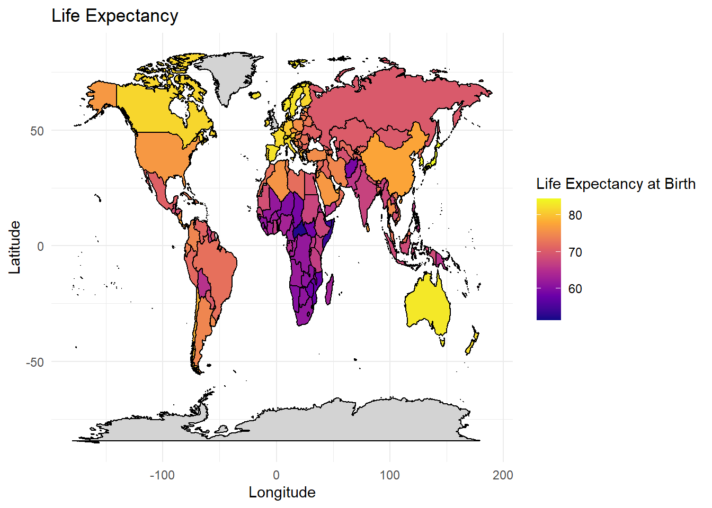
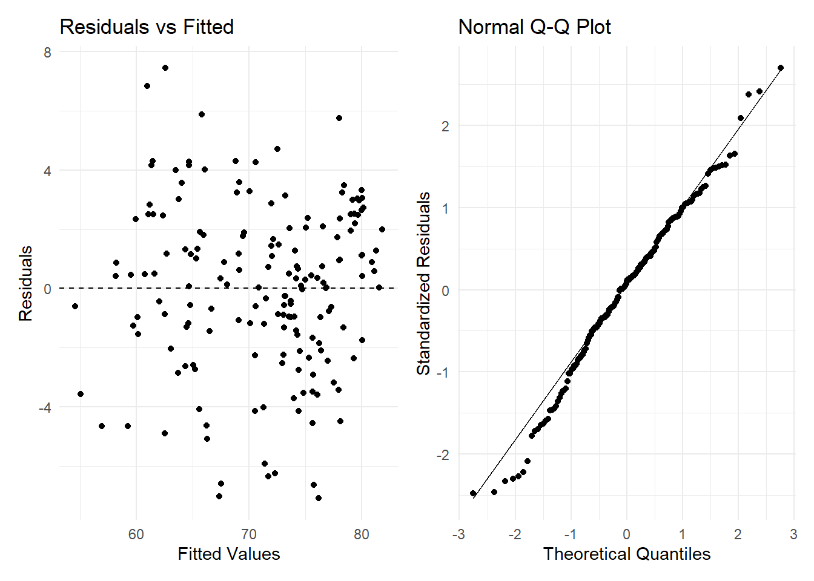

Final project for STAT 4210 Regression Analysis (Kennesaw State University), December 2024. The report is the main write-up; this page summarizes it.

## Question

Which country-level factors are associated with life expectancy at birth, and how well can a multiple linear regression model predict it?

## The Report

<iframe src="Life-Expectancy-Final-Report.pdf" title="Final report" width="100%" height="520" style="border: 1px solid var(--bs-border-color);"></iframe>

[Download the report (PDF)](Life-Expectancy-Final-Report.pdf){.btn .btn-outline-primary .btn-sm}
[Code and data on GitHub](https://github.com/kai-do/life-expectancy){.btn .btn-outline-primary .btn-sm}

## Data

The data is World Health Organization (WHO) country-level data for 2021 from the Global Health Observatory and World Health Statistics. Life expectancy at birth is reported for 185 countries, with a mean of 71.3 years (SD 7.1). Japan is highest at 84.46 years and Lesotho lowest at 51.48.

Six predictors were considered:

- homicide rate
- unintentional poisoning mortality rate
- suicide mortality rate
- road traffic mortality rate
- universal health coverage (UHC) service coverage index
- domestic general government health expenditure

Countries missing any variable in a model were dropped (listwise deletion), which left 175 countries for the initial model and 179 for the refined model.

## Approach

Three multiple linear regression models were fit and compared on RMSE, adjusted R², AIC and BIC:

1. **Initial model:** all six predictors (175 countries).
2. **Refined model:** dropped government health expenditure, which was not significant at the 0.05 level (179 countries).
3. **Final model:** the same five predictors, fit with 10-fold cross-validation and with influential outliers removed using a Cook's distance cutoff of 4/n (171 countries).

| Model | Countries | RMSE (years) | Adjusted R² | AIC | BIC |
|---|---|---|---|---|---|
| Initial (6 predictors) | 175 | 2.81 | 0.838 | 873.7 | 899.1 |
| Refined (5 predictors) | 179 | 2.82 | 0.840 | 893.2 | 915.5 |
| Final (cross-validated, outliers removed) | 171 | 2.83 | 0.838 | 854.9 | 876.9 |

## Results

::: {.callout-important title="Key Finding"}
Five country-level factors explain about 84% of the variation in life expectancy across countries. Universal health coverage is the strongest predictor: each additional point on the UHC service coverage index is associated with about 0.32 more years of life expectancy.
:::

The final model explains about 84% of the variation in life expectancy across countries (adjusted R² = 0.838, residual standard error 2.88 years, F = 177.1 on 5 and 165 degrees of freedom).

| Predictor | Estimate (years per unit) | Std. error | p-value |
|---|---|---|---|
| Intercept | 55.36 | 1.55 | < 0.0001 |
| Suicide mortality rate | −0.157 | 0.042 | 0.0002 |
| Unintentional poisoning mortality rate | −1.699 | 0.398 | < 0.0001 |
| Homicide rate | −0.100 | 0.018 | < 0.0001 |
| Road traffic mortality rate | −0.106 | 0.039 | 0.007 |
| UHC service coverage index | 0.317 | 0.019 | < 0.0001 |

Holding the other predictors constant, higher mortality from suicide, unintentional poisoning, homicide and road traffic is associated with lower life expectancy, and higher UHC service coverage is associated with higher life expectancy. The coefficients are per unit of each predictor, so their sizes are not directly comparable. The UHC index is the strongest single predictor (t = 17.0, and a correlation of 0.85 with life expectancy): each additional point is associated with about 0.32 more years of life expectancy.

### Assumption Checks

| Check | Statistic | p-value |
|---|---|---|
| Shapiro-Wilk (normality of residuals) | 0.989 | 0.236 |
| Kolmogorov-Smirnov (normality of residuals) | 0.050 | 0.781 |
| Breusch-Pagan (constant variance) | 6.03 | 0.303 |
| Non-constant variance test | 2.89 | 0.089 |

Variance inflation factors ranged from 1.10 to 1.90, well under the usual threshold of 5, so multicollinearity is not a concern. The non-constant variance test is marginal, and the Q-Q plot shows a slight departure from normality in the lower tail.

## Limitations

- **Association, not causation.** This is observational, cross-sectional data, so the coefficients describe associations between countries and do not show that changing a predictor would change life expectancy.
- **One year.** The 2021 snapshot says nothing about trends over time. Time-series data would be needed to study change.
- **Narrow set of predictors.** Education, income inequality and environmental conditions were not considered.
- **Missing data.** Dropping countries with missing values may bias results if the countries with gaps differ systematically from the rest.
- **Comparing models.** The three models were fit to different numbers of countries, so their AIC and BIC values are not directly comparable. On RMSE and adjusted R² the three models are nearly indistinguishable.

## Tools and Data Source

R and Quarto: tidyverse (including ggplot2), caret for cross-validation, car and lmtest for diagnostics, broom, GGally, patchwork, kableExtra, and the maps package for the world map.

Data: World Health Organization, [Global Health Observatory](https://www.who.int/data/gho) and [World Health Statistics](https://www.who.int/data/gho/data/themes/world-health-statistics), used under the [CC BY-NC-SA 3.0 IGO](https://creativecommons.org/licenses/by-nc-sa/3.0/igo) licence. This project is not endorsed by or affiliated with WHO.

## Links

- [Final report (PDF)](Life-Expectancy-Final-Report.pdf)
- [Code and data on GitHub](https://github.com/kai-do/life-expectancy)
